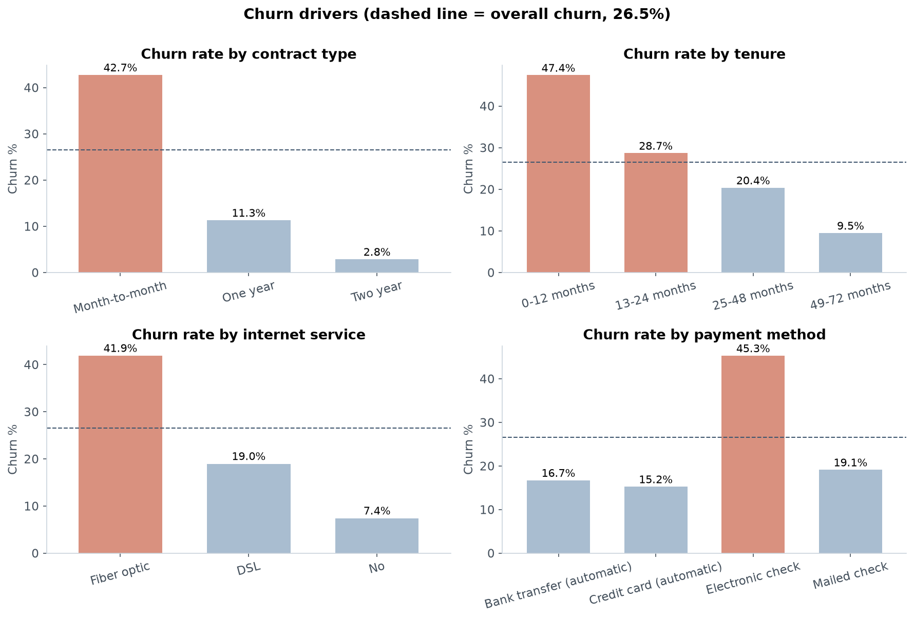

# Customer Churn Analysis

**Which telecom customers are about to leave, why, and who should the retention team call first?**

I analysed 7,043 customers from the public IBM Telco Customer Churn dataset using SQL, Python and Power BI. Below is what I found, how I checked it, and the dashboard I built from it.

## What I found

| Question | Answer |
|---|---|
| How many customers left? | **1,869 of 7,043 (26.5%)**, about 1 in 4 |
| What did that cost? | **$139,131 a month**, which is 30.5% of all monthly revenue |
| What matters most? | **Contract type.** Month-to-month customers churn at 42.7%, two-year customers at 2.8% |
| When do people leave? | **In their first year.** 47.4% of customers with 12 months or less left |
| Which groups stand out? | Fibre optic customers (41.9%) and people paying by electronic check (45.3%) |
| Who is most at risk? | New month-to-month fibre customers paying by electronic check: **71.2% churn** (631 customers) |
| What helps keep people? | Online security and tech support: about **15%** churn with them, **42%** without |
| Who should be called first? | The riskiest 30% of customers (by model score) include **66.4%** of everyone who left |
| What could it be worth? | If a campaign kept 10% of the people who left, that is roughly **$167K a year** in revenue |

## Power BI dashboard

I built a three-page dashboard: what is driving churn, a call list for the retention team, and how much revenue is at stake.


It uses a single-table model, 13 DAX measures and a custom colour theme. The call list and the risk-band charts only use customers the model had never seen, so the scores are not flattered. Files are in [`powerbi/`](powerbi/).

## How I got there

I started by cleaning the data. `TotalCharges` was stored as text, and 11 rows were blank. All 11 were customers with zero months of tenure who had not been billed yet, so I set them to 0 and kept them. There were no duplicate customer IDs.

Then I compared churn across customer groups.




A few checks I did to make sure these patterns are real:

- **Are the differences statistically real?** Yes for contract, tenure, internet service, payment method and add-on services. I also measured how big each effect is (Cramer's V). Contract is the biggest at 0.41. Gender and phone service have no link to churn (about 0.01), so I ignored them.
- **Is fibre only a contract effect?** No. Fibre customers churn more than DSL customers inside every contract type, for example 54.6% vs 32.2% on month-to-month plans. Something about the fibre service itself is worth looking into.

## Predicting who will leave

I trained a Logistic Regression model on 75% of customers and tested it on the other **1,761**, whom it had never seen.

| Measure | Result | What it means |
|---|---|---|
| Recall | **79.7%** | It catches about 4 in 5 customers who really leave |
| Precision | 51.9% | About half of the customers it flags really leave |
| Accuracy | 75.0% | It is right about 3 times out of 4 overall |
| AUC | **0.846** | It ranks leavers above stayers well |

I focused on recall because missing someone who is about to leave costs more than one extra phone call.


| Risk band | Customers | Actually churned |
|---|---|---|
| Low (below 0.30) | 761 | 4.5% |
| Medium (0.30 to 0.60) | 393 | 24.9% |
| High (0.60 and above) | 607 | 55.2% |

**Did I need a fancier model?** No. With 5-fold cross-validation, Logistic Regression scored an AUC of 0.845, Random Forest 0.844 and Gradient Boosting 0.847. They are the same, so I kept the simple one. It is just as accurate and I can explain every factor to a business team.

**Choosing who to call.** A low cut-off (0.3) catches 93% of leavers but means calling 57% of customers. A higher one (0.6) calls 34% of customers but misses more. A real team would pick the cut-off based on what a call costs and what a saved customer is worth. The notebook has the full table.

## What I would recommend

1. **Look after new customers early.** Check in at 30, 90 and 180 days.
2. **Offer longer contracts** to month-to-month customers, starting with the High-risk group.
3. **Move electronic-check payers to automatic payment.**
4. **Bundle online security and tech support**, especially for fibre customers.
5. **Look into fibre pricing and quality.**
6. **Re-score customers every month** and use the risk bands to decide who gets which offer.

I would test each idea on a small group first. The data shows what goes together with churn, not what causes it.

## Limits of this analysis

- It is public data for a made-up company, so a real telecom business may look different.
- It is a single snapshot. Complaints, usage or satisfaction data would probably improve the model.
- The $167K figure is revenue, not profit. It ignores the cost of the campaign and assumes the customers who stay would remain for a full year.
- I did not tune the models heavily. Since all three scored about the same, I do not expect tuning to change much.

## What is in this repository

| Path | What it is |
|---|---|
| [`notebooks/churn_analysis.ipynb`](notebooks/churn_analysis.ipynb) | The full analysis, step by step, with charts and explanations |
| [`sql/churn_analysis_queries.sql`](sql/churn_analysis_queries.sql) | 10 SQL queries (grouping, CASE, CTE, window function) with the results I expect |
| [`powerbi/`](powerbi/) | Power BI project, the scored dataset, the colour theme and notes on how I built it |
| [`analysis/churn_analysis.py`](analysis/churn_analysis.py) | A script version that reproduces the key numbers and writes the Power BI dataset |
| [`data/`](data/) | The source data |
| [`extras/web-app/`](extras/web-app/) | A small interactive version I built as an extra (FastAPI and React) |

**To reproduce the numbers**

```bash
pip install -r requirements.txt
python analysis/churn_analysis.py
```

## Data

IBM Telco Customer Churn (`WA_Fn-UseC_-Telco-Customer-Churn.csv`): 7,043 customers, 21 columns.

**Author:** Nida Farheen Khan · [LinkedIn](https://www.linkedin.com/in/nida-khan-237715279)
