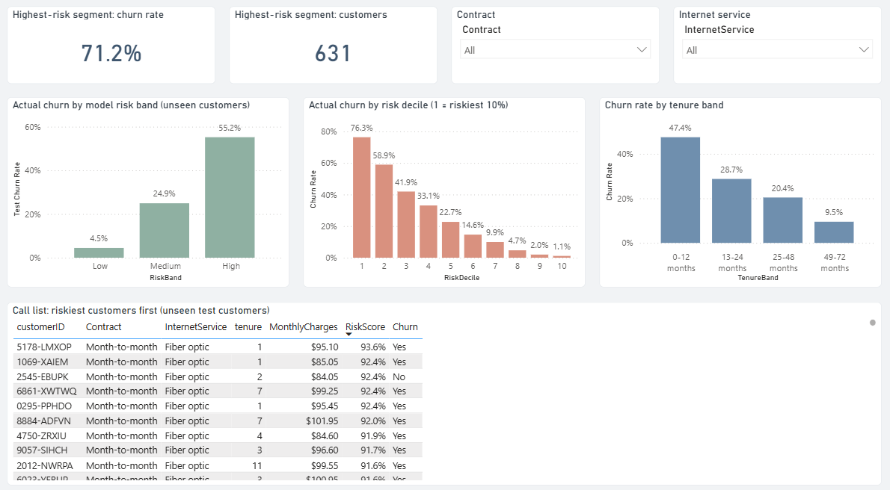
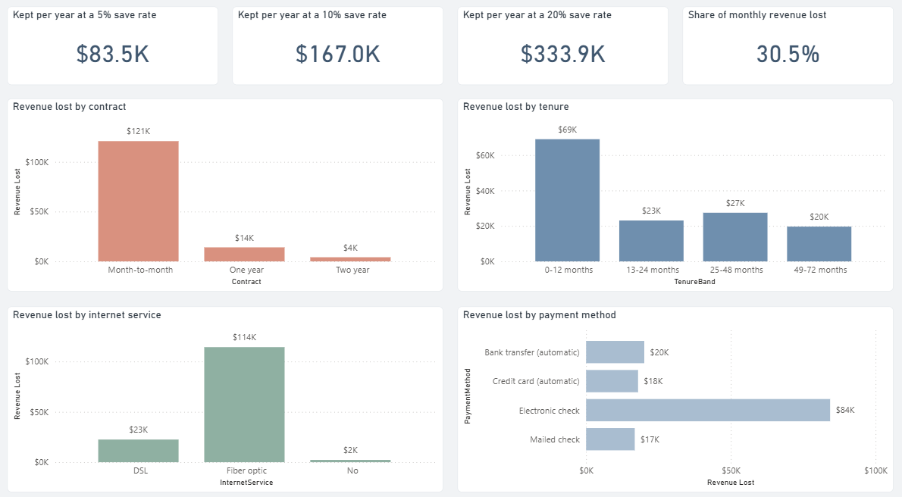
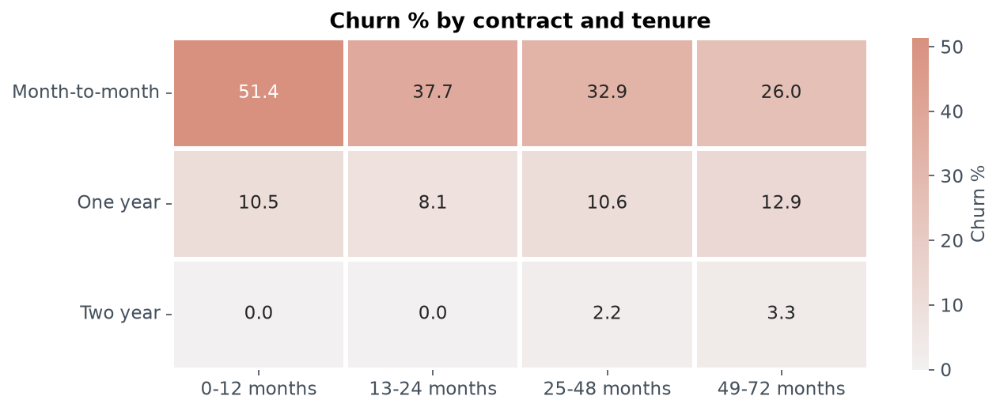

# Customer Churn Analysis

I looked at 7,043 customers from the public IBM Telco Customer Churn dataset to see who is leaving, why, and who a retention team should call first. I used SQL, Python and Power BI.

I wrote it with a retention team lead in mind, someone who needs a short list of customers to call each week and a rough idea of what that's worth.

This dataset is used a lot, so here's what I added on top of the usual churn analysis:

- I checked whether fibre customers churn more only because of their contracts. They don't.
- I scored customers with the model but only used customers it had never seen for the risk bands, so the numbers aren't flattered.
- I compared logistic regression with two other models before picking it.
- I put a rough revenue number on keeping some of the customers who leave.

## What I found

- 1,869 of 7,043 customers left (26.5%), about 1 in 4. They paid $139,131 a month, which is 30.5% of all monthly revenue.
- Contract type matters most. Month-to-month customers churn at 42.7% and two-year customers at 2.8%.
- People leave early. 47.4% of customers with 12 months or less of tenure left.
- Fibre optic customers (41.9%) and people paying by electronic check (45.3%) churn more than the rest.
- The riskiest group is new month-to-month fibre customers paying by electronic check. 631 customers, 71.2% churn.
- Customers with online security and tech support churn at about 15%. Without them it's about 42%.
- If I rank customers by model score, the riskiest 30% include 66.4% of everyone who left.
- If a campaign kept 10% of the people who left, that's roughly $167K a year in revenue.

## Power BI dashboard

Three pages: what drives churn, a call list for the retention team, and the revenue at stake. The call list and risk-band charts only use customers the model had never seen.






It's a single-table model with 13 DAX measures. Files are in [`powerbi/`](powerbi/).

## How I built it

`TotalCharges` was stored as text and 11 rows were blank. All 11 were customers with zero months of tenure who hadn't been billed yet, so I set them to 0 and kept them. There were no duplicate customer IDs. Then I compared churn across customer groups.




Chi-square tests and Cramer's V (effect size) show that contract, tenure, internet service, payment method and add-on services are all linked to churn. Contract is the strongest at 0.41. Gender and phone service show nothing (about 0.01), so I ignored them.

Fibre isn't only down to contract type either. Fibre customers churn more than DSL customers inside every contract type, for example 54.6% vs 32.2% on month-to-month plans.

## The model

I trained a Logistic Regression on 75% of customers and tested it on the other 1,761. I focused on recall because I figured a wasted call is cheaper than losing a customer. With real call costs I'd want to check that.

| Measure | Result |
|---|---|
| Recall | 79.7% |
| Precision | 51.9% |
| Accuracy | 75.0% |
| AUC | 0.846 |

So it catches about 4 in 5 leavers, and about half of the customers it flags really do leave.


I used the score to split customers into risk bands. Among the unseen customers, 4.5% of Low (below 0.30, 761 customers) churned, 24.9% of Medium (0.30 to 0.60, 393) and 55.2% of High (0.60 and above, 607).

A fancier model didn't help. With 5-fold cross-validation, Logistic Regression scored an AUC of 0.845, Random Forest 0.844 and Gradient Boosting 0.847. I kept the simple one because I can explain it to a business team.

The cut-off decides who gets a call. At 0.3 the model catches 93% of leavers but you'd call 57% of customers. At 0.6 you call 34% but miss more. I used 0.30 and 0.60 for the bands and didn't try to tune them.

## What I'd do next

These are ideas from the data, I haven't tested any of them. Check in with new customers at 30, 90 and 180 days. Offer longer contracts to month-to-month customers, starting with the High-risk group. Move electronic-check payers to automatic payment, bundle online security and tech support for fibre customers, and look at fibre pricing and quality. Re-score customers every month.

## Limits

- It's public data for a made-up company, and it's one snapshot in time.
- It shows what goes together with churn, not what causes it.
- The $167K is revenue, not profit, and ignores what a campaign costs.
- I didn't tune the models much, though all three scored about the same.

## What's in this repository

- [`notebooks/churn_analysis.ipynb`](notebooks/churn_analysis.ipynb) has the full analysis with charts.
- [`sql/churn_analysis_queries.sql`](sql/churn_analysis_queries.sql) has 12 SQL queries (grouping, CASE, CTEs, window functions like NTILE and a running total) with the results I expect.
- [`powerbi/`](powerbi/) has the Power BI project, the scored dataset, the colour theme and build notes.
- [`analysis/churn_analysis.py`](analysis/churn_analysis.py) is a script that reproduces the main numbers and writes the Power BI dataset.
- [`data/`](data/) has the source data (IBM Telco Customer Churn, 7,043 customers, 21 columns) and a short [column guide](data/README.md).
- [`extras/web-app/`](extras/web-app/) is a small interactive version I built as an extra, with FastAPI and React.

To run it:

```bash
pip install -r requirements.txt
python analysis/churn_analysis.py
```

Author: Nida Farheen Khan · [LinkedIn](https://www.linkedin.com/in/nida-khan-237715279)
