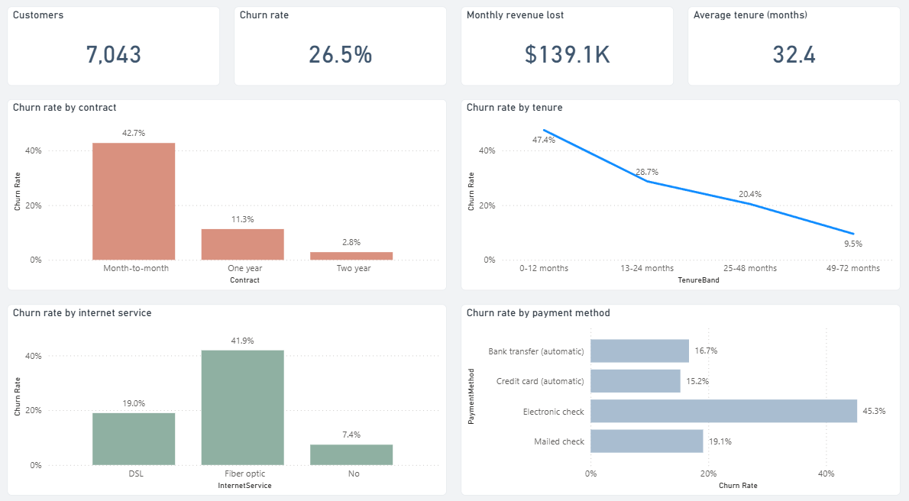
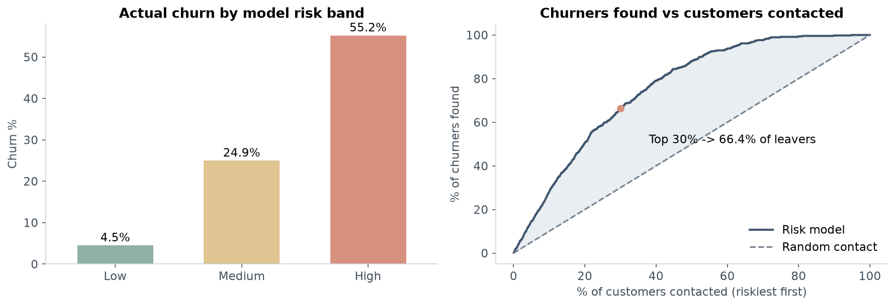

# Customer Churn Analysis

**Which telecom customers are likely to leave, why, and who should the retention team contact first?**

An end-to-end analysis of 7,043 customers from the public IBM Telco Customer Churn dataset, using **SQL, Python and Power BI**.

## Key findings

| Question | Answer |
|---|---|
| How many customers left? | **1,869 of 7,043 (26.54%)**, about one in four |
| How much revenue did they take? | **$139,131 a month, 30.5%** of all monthly charges |
| What mattered most? | **Contract type.** Month-to-month: 42.71% churn. Two-year: 2.83% |
| When is risk highest? | **The first year.** 47.44% of customers with 0-12 months' tenure left |
| Which groups stood out? | Fibre optic users (41.89%), electronic check payers (45.29%) |
| Riskiest segment? | New month-to-month fibre customers paying by electronic check: **71.2% churn** (631 customers) |
| What reduces churn? | Online security and tech support: about **15%** churn with them vs **42%** without |
| Who should be called first? | The riskiest 30% of customers (by model score) contain **66.4%** of all leavers |
| What is it worth? | Saving 10% of churners keeps about **$167K a year** |

## Power BI dashboard

Three pages built from the cleaned, scored dataset: an overview of churn drivers, a call list for the retention team, and the revenue at stake.




Built with Power Query, a single-table model, 13 DAX measures (churn rate, revenue lost, segment churn, retained revenue at 5/10/20% save rates) and a custom colour theme. The call list and risk-band charts use only customers the model had never seen. See [`powerbi/`](powerbi/).


## Analysis


Chi-square tests confirmed that contract, tenure, internet service, payment method and add-on services are all linked to churn (p < 0.001). Gender and phone service are not.

## Predicting who will leave

A Logistic Regression model with balanced class weights was trained on 75% of customers and tested on the remaining **1,761** customers it had never seen.

| Measure | Result | In plain words |
|---|---|---|
| Recall | **79.66%** | Catches about 4 in 5 customers who actually leave |
| Precision | 51.88% | About half of flagged customers actually leave |
| Accuracy | 75.01% | Correct for 3 in 4 customers overall |
| AUC | **0.846** | Ranks leavers above stayers well |

**Why recall over accuracy?** Missing a customer who is about to leave usually costs more than one extra courtesy call.



| Risk band (probability) | Customers | Actually churned |
|---|---|---|
| Low (below 0.30) | 761 | 4.47% |
| Medium (0.30 to 0.60) | 393 | 24.94% |
| High (0.60 and above) | 607 | 55.19% |

## Recommendations

1. **Support new customers early.** Check in at 30, 90 and 180 days.
2. **Offer contract upgrades** to high-risk month-to-month customers.
3. **Move electronic-check payers to automatic payment.**
4. **Bundle online security and tech support,** especially for fibre customers.
5. **Review fibre pricing and quality.** Fibre churn is higher at every tenure level.
6. **Score customers monthly** and assign actions by risk band.

Test each action on a small group first. These results show association, not proof of cause.

## Repository

| Path | What is inside |
|---|---|
| [`notebooks/churn_analysis.ipynb`](notebooks/churn_analysis.ipynb) | Full analysis: cleaning, EDA, statistical tests, model, risk bands, revenue impact |
| [`sql/churn_analysis_queries.sql`](sql/churn_analysis_queries.sql) | 10 queries (GROUP BY, CASE, CTE, window function) with expected results |
| [`powerbi/`](powerbi/) | Power BI project (`.pbip`), scored dataset, theme and build guide |
| [`analysis/churn_analysis.py`](analysis/churn_analysis.py) | Script version of the analysis; also writes the Power BI dataset |
| [`data/`](data/) | Source data |
| [`extras/web-app/`](extras/web-app/) | Optional interactive version (FastAPI + React) |

**Data cleaning:** converted `TotalCharges` from text to numbers; the 11 blank values all belong to customers with 0 months' tenure who had not been billed yet, so they were set to 0. No duplicate customer IDs.

**Reproduce the numbers**

```bash
pip install -r requirements.txt
python analysis/churn_analysis.py
```

## Limitations

- Public data for a hypothetical company, so results may differ for a real telecom business
- A single snapshot with no complaint, usage or satisfaction data
- Findings show association, not causation
- Only Logistic Regression was tested. Comparing it with Random Forest is a planned next step.

## Dataset

IBM Telco Customer Churn (`WA_Fn-UseC_-Telco-Customer-Churn.csv`): 7,043 customers, 21 columns.

**Author:** Nida Farheen Khan · [LinkedIn](https://www.linkedin.com/in/nida-khan-237715279)
